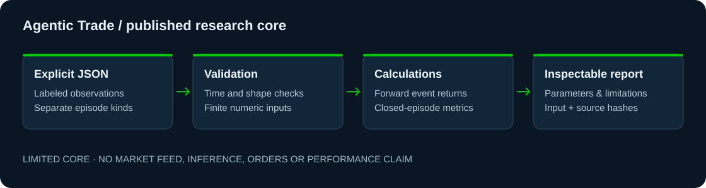

# Agentic Trade Research Core

**Building intelligence that earns its conclusions.**

Agentic Trade Machine (ATM) investigates whether autonomous research systems can identify market opportunities, challenge their own assumptions and produce independently evaluated economic evidence. Its purpose is to test ideas that could be wrong, preserve the evidence and determine which conclusions survive scrutiny.

The private ATM architecture brings together research governance, falsifiable hypotheses, deterministic evaluation, risk boundaries and independent validation. **This public research core is one limited component of that architecture.** It calculates conditional forward returns and closed-episode summaries from explicit JSON inputs, with validation, cost assumptions and reproducibility hashes.

The core does not discover strategies, connect to market data, invoke models or execute trades. Passing tests demonstrate the exercised software behavior. They do not establish profitability.

[Run the examples](#quick-start) · [Architecture](docs/ARCHITECTURE.md) · [Research method](docs/RESEARCH.md) · [Verification](docs/VERIFICATION.md) · [Portfolio](https://github.com/EtherTabu)



## Problem and objective

Market research depends on when information was available, how a hypothesis was formed and which evidence is independent of its development. A study can appear successful if it uses future information, omits costs or treats a small sample as a durable result. Episode statistics can also be mistaken for account performance.

This core makes calculation inputs, timing rules, costs and outcome definitions explicit. It supports evaluation within a governed research process; it does not supply the entire process or prove the hypothesis being evaluated.

## Demonstrated capabilities

| Function | Included behavior | Important boundary |
|---|---|---|
| Conditional event study | Completed signal bar, entry at the next bar's open, explicit horizon, direction and costs per side | Not an account backtest; no options, calendar or liquidity validation |
| Journal summary | Separate paper, live and passed records; closed-episode counts, net outcomes and descriptive risk metrics | Supplied records only; no brokerage reconciliation or marked-to-market equity curve |
| Validation | Timezone-aware clocks, ordered non-overlapping bars, finite values and duplicate JSON key rejection | Source quality, point-in-time integrity and independent holdout design remain the researcher's responsibility |
| Reproducibility | Input and source SHA-256 hashes, explicit parameters and limitations | A matching hash establishes bytes, not the truth of an economic conclusion |

## Quick start

Python 3.10 or later. No pip packages, API keys or accounts are required. Tested with Python 3.13.13.

```sh
python -B -m unittest discover -s tests -v
python -B scripts/research_tools.py study samples/study.json --holding-bars 1 --cost-bps 10
python -B scripts/research_tools.py journal samples/journal.json --kind paper --group-by setup
```

Both examples use invented inputs. The journal includes a loss. These outputs are calculation fixtures, not a performance record. The program reads only the local files supplied to it and makes no network or model calls.

## How this relates to ATM

The wider private system connects evidence receipts, supervised hypotheses, governed experiments, deterministic observation and outcome review. [ARCHITECTURE.md](docs/ARCHITECTURE.md) distinguishes that system from the two calculation functions released here. Provider adapters, activation paths, account details, historical market captures, model inference and private research are excluded.

Independent strategy validation requires evidence beyond these calculations, including untouched holdout samples and realistic costs. [RESEARCH.md](docs/RESEARCH.md) explains the methodological gaps and open questions. No repeatable financial edge has been established.

## Governance

The published core contains no broker connection, risk parameter control, scheduler, order path or paid inference. The journal's `--kind live` label classifies supplied records; it does not place a trade or authenticate an account. The private system's human authorization boundary remains separate from this calculator.

## Verification and development status

All 15 existing synthetic tests pass. Both documented examples run using only the Python standard library. See [VERIFICATION.md](docs/VERIFICATION.md) for the procedure and its limits. Production readiness and suitability for investment decisions remain unverified.

## License

[MIT](LICENSE) covers the released first-party source, tests and documentation. [NOTICE.md](NOTICE.md) explains the extraction boundary. No proprietary market data is distributed.
