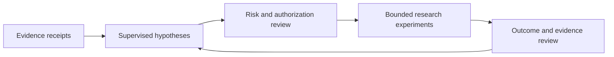

# Architecture and release boundary

## Published implementation

Explicit JSON → validation → event-study or journal calculation → structured report with parameters, limitations and input/source hashes. The implementation is scripts/research_tools.py; its 15 existing synthetic tests are in tests/test_research_tools.py. It uses only the Python standard library.

## Wider ATM context — not distributed here

This describes the documented private system, not additional shipped components. Its later finite-observation adapter was qualified offline; live activation remains a separate, closed gate. A historical software test does not validate provider permissions, market coverage, future outcomes or profitability.

Excluded: provider adapters and accounts, model credentials/inference, execution and activation controls, persisted market data, private hypotheses, operational logs, financial records and historical Git metadata. A broader release needs a separate redistribution/privacy review. This deliberately narrow package is independently runnable without those materials.
